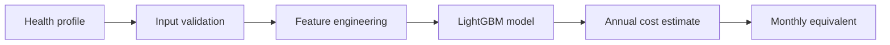
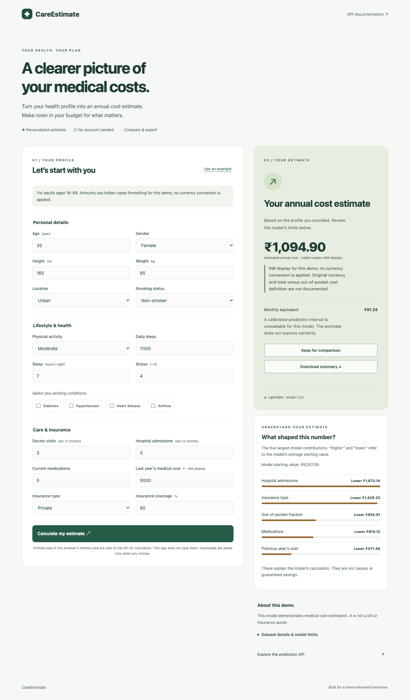
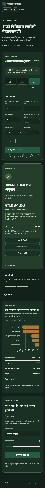

<div align="center">

# ✚ CareEstimate

### A clearer picture of your medical costs.

A medical cost planner for people exploring annual healthcare budgets, powered by a trained LightGBM model and a FastAPI prediction service.

[](https://github.com/Priyanshuraj0909/medical-cost-app/actions/workflows/ci.yml)


**[Live Demo](https://medical-cost-app-king-09.vercel.app)** · **[API Docs](https://medical-cost-app-king-09.vercel.app/docs)** · **[Report an Issue](https://github.com/Priyanshuraj0909/medical-cost-app/issues)**

</div>

---

## Contents

[About](#about-the-project) · [Getting Started](#getting-started) · [Usage](#usage) · [Testing](#testing) · [Deployment](#deployment) · [Roadmap](#roadmap) · [Contributing](#contributing) · [License](#license)

## About the Project

CareEstimate turns a health profile into an estimated annual medical cost. Its responsive web interface collects demographic, lifestyle, medical history, and insurance details, then sends them to the repository’s trained LightGBM model through FastAPI.

The project provides both a browser experience for exploring costs and a documented REST API for developers integrating predictions into other applications.

### Key Features

- **Guided, bilingual experience:** Three validated steps, a show-all option, English/Hindi switching, local Hindi fonts, and light/dark themes.
- **Interactive exploration:** Chart.js contribution and comparison charts, plus a scenario slider that changes one input without modifying the main profile.
- **Explained estimates:** Annual predictions, monthly equivalents, all 20 feature contributions in a waterfall with accessible running totals, and explicit uncertainty status.
- **Scenario workspace:** Save, rename, remove and compare up to six scenarios for the current profile; include them in JSON downloads and printable reports.
- **Batch CSV workflow:** Validate up to 50 profiles (128 KiB), review row-level errors, predict valid rows, and download results with model warnings and dataset notes.
- **Compare and export:** Keep one estimate, change a profile, compare the results, and download a JSON summary or print a report to save as PDF without raw profile inputs. Comparisons stay in browser memory.
- **Validated prediction API:** Shared training/serving preprocessing, age scope checks, insurance consistency validation, out-of-range warnings, and model checksum/feature-order verification.
- **Installable app:** A PWA manifest and public-shell service worker let the interface open offline. Predictions require a connection; profiles and API responses are never cached by the service worker.
- **Evaluation and operations:** Offline baseline comparisons, grouped cross-validation, calibration/test splits, subgroup error reports, diagnostic plots, and process-local aggregate metrics.
- **Deployment and verification:** Vercel configuration, Docker packaging, a Render Blueprint, API/training tests, and desktop/mobile browser and accessibility checks.

### Built With

| Layer | Technologies |
| --- | --- |
| Web interface | HTML5, CSS3, JavaScript, Chart.js, English/Hindi, PWA |
| API | Python, FastAPI, Uvicorn, Pydantic |
| Model and numerical processing | LightGBM, scikit-learn, NumPy, pandas, SciPy; optional MLflow tracking |
| Testing and CI | pytest, HTTPX, Playwright, axe-core, GitHub Actions |
| Hosting and packaging | Vercel, Docker, Render configuration |

### How It Works



> [!NOTE]
> The web interface uses **Indian rupee display (₹, INR)** with Indian digit grouping, for example **₹1,23,456.78**. This is a demo presentation choice: no exchange-rate conversion is applied, and the original training currency remains unverified. API `currency` continues to describe the training units; downloaded summaries separately record the INR display choice. The monthly figure is the annual estimate divided by twelve.

## Getting Started

### Prerequisites

- **Python 3.12** recommended; the pinned dependencies support Python 3.10–3.12.
- **Git** and **pip**.
- An **OpenMP runtime** for LightGBM. Docker installs this automatically.
- **Docker** only if you prefer running a container.

On macOS, install OpenMP if LightGBM reports a missing library:

```bash
brew install libomp
```

On Debian/Ubuntu:

```bash
sudo apt-get update
sudo apt-get install -y libgomp1
```

### Installation

1. **Clone the repository.**

   ```bash
   git clone https://github.com/Priyanshuraj0909/medical-cost-app.git
   cd medical-cost-app
   ```

2. **Create and activate a virtual environment.**

   ```bash
   python3.12 -m venv .venv
   source .venv/bin/activate
   ```

   On Windows, use an installed Python 3.12 interpreter:

   ```powershell
   py -3.12 -m venv .venv
   .venv\Scripts\Activate.ps1
   ```

3. **Install dependencies.**

   ```bash
   pip install -r requirements.txt
   ```

4. **Start the application.**

   ```bash
   uvicorn app:app --reload --host 127.0.0.1 --port 8000
   ```

Open **[localhost:8000](http://localhost:8000)**. No account, database, or environment variables are required.

### Run with Docker

```bash
docker build -t medical-cost-app .
docker run --rm -p 8000:8000 medical-cost-app
```

The image runs as a non-root user, includes OpenMP, and checks `/health`. Its internal `PORT` defaults to `8000`.

## Usage

### Web Interface

1. Open the [live app](https://medical-cost-app-king-09.vercel.app) or your local instance.
2. Complete **Personal → Health → Insurance** using **Continue** and **Back**. Invalid fields show inline guidance. **Show all fields** opens the complete form.
3. Select **Calculate my estimate** to view the annual prediction and monthly equivalent.
4. Follow the full prediction waterfall from the base value through 20 contributions. Expand the table for exact running totals; review the uncertainty note and range warnings.
5. Select **Keep for comparison**, change inputs, then calculate again to compare profiles.
6. Explore the scenario panel to change one factor and compare an alternate estimate without editing your main profile.
7. Save up to six scenarios to the **Scenario workspace**, rename them, and compare their estimates and changed factors. Editing the main form clears saved scenarios.
8. Use **Batch CSV estimates** to download a template, upload a UTF-8 CSV, select **Validate CSV**, then **Predict valid rows** and **Download results CSV**. Invalid rows remain in the results with field errors.
9. Select **Download summary** for JSON, or **Print / Save PDF** for a browser-generated report. **Clear comparison** removes the kept estimate.
10. Use the header to switch English/Hindi or light/dark mode. Where supported, **Install app** adds the app to your device.

**Use an example** restores the sample profile. The interface uses preceding-12-month care counts; the legacy dataset’s timing remains unverified. Model associations do not establish causal effects or guaranteed savings.



<details>
<summary>Hindi and dark mode preview</summary>



</details>

### API Endpoints

| Method | Endpoint | Purpose |
| --- | --- | --- |
| `GET` | `/` | Web interface |
| `POST` | `/predict` | Annual medical cost prediction |
| `POST` | `/batch/validate` | Preview CSV row validation without inference |
| `POST` | `/batch/predict` | Predict valid CSV rows; retain invalid rows and service errors |
| `GET` | `/health` | Service status and model readiness |
| `GET` | `/model-info` | Provenance, model scope and validation status |
| `GET` | `/metrics` | Process-local aggregate counters in Prometheus format |
| `GET` | `/docs` | Interactive Swagger documentation |
| `GET` | `/redoc` | ReDoc API reference |

### Prediction Example

Run this against a local instance. Replace the host with the live URL to call the deployed API.

```bash
curl --request POST http://localhost:8000/predict \
  --header 'Content-Type: application/json' \
  --data '{
    "age": 35,
    "gender_raw": "female",
    "height_cm": 165,
    "weight_kg": 65,
    "city": "urban",
    "smoker_raw": "no",
    "physical_activity_level_raw": "medium",
    "daily_steps": 7000,
    "sleep_hours": 7,
    "stress_level": 4,
    "diabetes": 0,
    "hypertension": 0,
    "heart_disease": 0,
    "asthma": 0,
    "doctor_visits_per_year": 3,
    "hospital_admissions": 0,
    "medication_count": 0,
    "previous_year_cost": 5000,
    "insurance_type_raw": "private",
    "insurance_coverage_frac": 0.8
  }'
```

The response retains `predicted_medical_cost` and adds model version, currency, warnings, full feature contributions, uncertainty status, an optional calibrated interval, and structured `dataset_status` documentation notes. Selected fields from the included model:

```json
{
  "predicted_medical_cost": 1094.9,
  "model_version": "1.0.0",
  "currency": "dataset units (currency unspecified)",
  "prediction_interval": null
}
```

<details>
<summary><strong>Input categories and validation</strong></summary>

| Field | Accepted values |
| --- | --- |
| `gender_raw` | `male`, `female` |
| `smoker_raw` | `yes`, `no` |
| `city` | `urban`, `semi-urban`, `rural`; `semi urban` is also accepted |
| `physical_activity_level_raw` | `low`, `medium`, `high` |
| `insurance_type_raw` | `private`, `government`, `no_insurance` |
| Condition flags | `0` or `1` |

Categories are trimmed and case-insensitive. The API accepts insurance coverage as a fraction from `0` to `1`; the web form accepts a percentage. BMI and the out-of-pocket fraction are derived automatically.

Ages must be **18–89**. `no_insurance` requires zero coverage. Unknown fields, invalid categories, non-finite numbers, negative counts/costs, zero height/weight, and out-of-range bounded inputs return **HTTP 422** without echoing submitted values. Other recorded training-range excursions return warnings. Missing dataset documentation appears separately in `dataset_status`, with a visible demo note beside the estimate. Model unavailability or prediction failures return **HTTP 503**.

</details>

### Batch API

Both batch endpoints accept a raw UTF-8 CSV body with `Content-Type: text/csv` (not multipart). Use the [CSV template](static/batch-template.csv) for column names. Coverage is a fraction from 0 to 1. Optional blank cells use the API defaults. Limits are 50 profiles and 131072 bytes; excess returns HTTP 413. Invalid headers, encoding or CSV structure return HTTP 400, and unsupported content types return HTTP 415.

```bash
curl http://localhost:8000/batch/validate \
  --header 'Content-Type: text/csv' --data-binary @static/batch-template.csv
curl http://localhost:8000/batch/predict \
  --header 'Content-Type: text/csv' --data-binary @static/batch-template.csv
```

Responses include counts and ordered rows with `row`, `status`, `errors`, and an optional full `prediction`. Row numbers identify CSV records (header is record 1), including quoted multiline records. Valid rows use the same inference and warnings as `/predict`. Profiles are validated again before inference. No upload or result is persisted; downloaded CSVs omit raw inputs, retain dataset currency and explicitly record the INR display convention.

## Testing

```bash
pip install -r requirements-dev.txt
python -m pytest -q
```

The Python suite covers actual model inference, feature parity, explanation reconciliation, validation, privacy of aggregate metrics, interval handling, bundle integrity, and an end-to-end offline training run on an explicitly synthetic test fixture. Fixture results are not production accuracy measurements.

Optional experiment-tracking integration tests require `pip install -r requirements-training.txt`. Without this extra, the MLflow test is skipped. Browser checks need Node.js 22 or newer:

```bash
npm ci
npx playwright install chromium
PYTHON_BIN=.venv/bin/python npm run test:browser
```

GitHub Actions also tests guided validation, scenarios, charts, PDF printing, Hindi/dark mode, offline behavior and accessibility; it builds Docker and checks container readiness. See [operations and browser testing](docs/OPERATIONS.md) for installed-Chrome and Windows options.

## Reproducible Training

The original CSV is absent. Before retraining, recover and document its provenance, license, currency, target meaning, and feature timing. See the [dataset evidence card](docs/DATA_CARD.md).

A new offline pipeline validates the raw schema, shares serving feature encoding, separates identical profile groups, compares median/Ridge/Random Forest/LightGBM, and generates CV/test metrics, subgroup errors, plots and split-conformal interval coverage. It writes a candidate bundle without changing the serving model.

```bash
python -m training.train --data data/medical_cost_prediction_dataset.csv \
  --data-card data/data-card.json --output artifacts/candidate-001
```

Complete the [data-card template](docs/data-card.template.json) first. Follow [training and promotion instructions](docs/TRAINING.md). No new accuracy claims or prediction intervals are assigned to the legacy model.

## Deployment

### Vercel

The app is deployed at **[medical-cost-app-king-09.vercel.app](https://medical-cost-app-king-09.vercel.app)**. The connected GitHub repository deploys automatically when changes are pushed to `main`. After the test and browser jobs pass, a production smoke job verifies the public URL, deployed version, exact frontend assets, CSV workflow, and individual predictions. Run `python scripts/check_production.py --attempts 1` to check the same release locally.

To deploy your own copy, import the repository into Vercel using the **FastAPI** preset. Alternatively, sign in and deploy with the CLI:

```bash
npx vercel login
npx vercel --prod
```

- `.python-version` selects Python 3.12.
- `vercel.json` configures the function and excludes development files.
- `vercel_build.py` bundles OpenMP from the Linux build machine; the app preloads it before loading LightGBM.
- The model and web assets are included; no environment variables are required.

See [Vercel’s FastAPI guide](https://vercel.com/docs/frameworks/backend/fastapi) for platform details.

### Render

A `render.yaml` Blueprint is included for Docker-based hosting. Connect your repository through **New → Blueprint**, review the service configuration, and deploy. The interface and API share one service, with `/health` configured as the health check. Review Render’s current plan options before deploying.

## Project Structure

```text
medical-cost-app/
├── batch.py                     # Bounded CSV parsing and row validation
├── app.py                       # API routes, startup, model inference
├── schema/                      # Shared validation and feature encoding
├── training/                    # Offline evaluation and optional MLflow tracking
├── scripts/                     # Reproducible local inference benchmark
├── docs/                        # Data card, training and operations guides
├── model_bundle.py              # Trusted bundle integrity checks
├── monitoring.py                # Aggregate process-local metrics
├── model/                       # Original trained LightGBM model
├── static/                      # Guided UI, translations, charts, fonts, PWA shell
├── tests/                       # API, offline training and browser tests
├── package.json                 # Development-only browser test dependencies
├── .github/workflows/ci.yml     # Automated tests and Docker checks
├── requirements.txt             # Runtime dependencies
├── requirements-dev.txt         # API/test dependencies
├── requirements-training.txt    # Optional offline MLflow client
├── .python-version              # Vercel Python version
├── vercel.json                  # Vercel configuration
├── vercel_build.py              # OpenMP bundling for Vercel
├── Dockerfile                   # Container packaging
├── render.yaml                  # Render Blueprint
└── LGBMRegressor_and_feature_engineering.ipynb
                                 # Original training notebook
```

## Roadmap

Implemented in this release:

- [x] Full 20-feature prediction waterfall with accessible running totals.
- [x] Six-scenario workspace with names, removal, charts, exports and reports.
- [x] CSV validation preview, partial batch predictions and result download.

- [x] Shared preprocessing and reproducible offline evaluation tooling.
- [x] Feature contributions, range warnings, and explicit uncertainty handling.
- [x] Profile comparisons and downloadable summaries.
- [x] Automated browser/accessibility checks and aggregate service metrics.
- [x] Guided form, scenario charts, English/Hindi, dark mode and printable reports.
- [x] Installable app shell with offline interface and no profile caching.
- [x] Single-pass inference, latency histogram and optional MLflow experiment tracking.

Remaining work that requires original source data:

- [ ] Verify dataset provenance, license, currency, population, synthetic status, and target meaning.
- [ ] Confirm feature availability before the prediction period.
- [ ] Run and publish a reviewed evaluation on that authorized dataset.
- [ ] Validate temporal/geographic generalization and prediction-interval coverage before promoting a replacement model.

## Contributing

Contributions are welcome through issues and pull requests.

1. Open an issue describing the bug or proposed improvement.
2. Fork the repository and create a focused feature branch.
3. Make your changes and update relevant documentation.
4. Run `python -m pytest -q`; add meaningful tests for behavior changes.
5. Submit a pull request explaining the change and how you verified it.

Keep request schemas, feature mappings, and model feature order consistent. Changes to the model should include their data source, training method, and evaluation results. Avoid committing personal health data, secrets, virtual environments, or generated files.

## Model Scope and Privacy

The original training dataset is not included. Its provenance, currency, intended population, and predictive performance on new users have not been verified. The training notebook and serialized model are provided for exploration and development.

The application does not save submitted profiles or log request bodies. Comparisons and scenarios live in browser memory; users explicitly choose whether to download or print summaries. Only language/theme preferences are saved in localStorage. The service worker caches public interface files, never profiles or API responses. Process-local metrics contain counters, not profiles, and reset on restart. Hosting-provider logging policies are outside this application. Only load pickle bundles from trusted sources. See [operations](docs/OPERATIONS.md).

> [!IMPORTANT]
> Predictions are estimates, not bills or insurance quotes. Confirm policy coverage and local care prices before using them to plan spending.

## License

**No license has been specified.** This repository currently contains no `LICENSE` file. Do not assume MIT, Apache 2.0, or another open-source license applies. The project owner should select a license and add its terms before granting broader reuse permissions.

---

<div align="center">

**CareEstimate** · Built for a more informed tomorrow.

[Try the App](https://medical-cost-app-king-09.vercel.app) · [Explore the API](https://medical-cost-app-king-09.vercel.app/docs)

</div>
